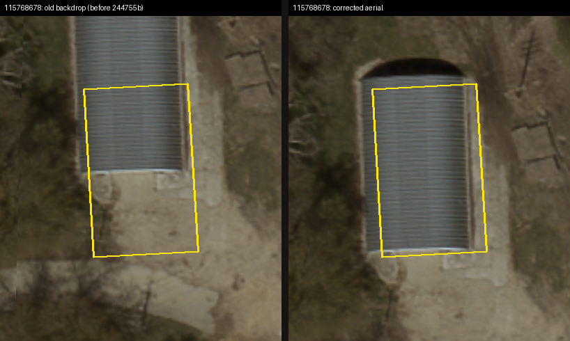
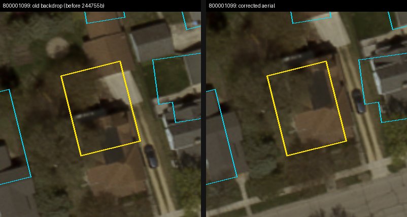
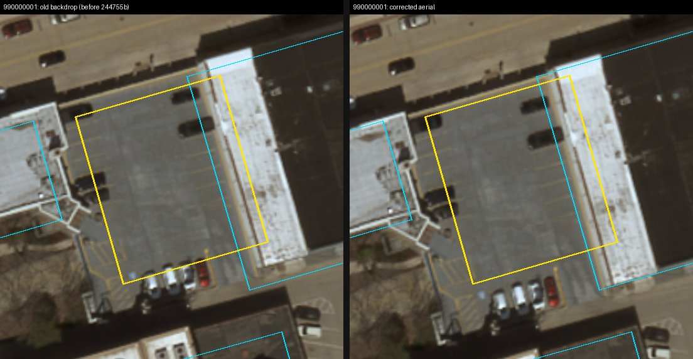

# Footprints traced on the shifted aerial: audit (2026-10-18)

Until 244755b, `pipeline/aerial/georef_affine.py` ignored the image server widening non-square
requests, so Composer's footprint backdrop (`/game-aerial`, live since 75dc243 on 2026-09-30)
drew the 2025 aerial off by:

| tiles | old backdrop error (median / 90th pct / max) |
|---|---|
| 25 full 512 m tiles (the town) | 7.8 / 13.8 / 14.5 m, almost all north-south |
| 11 edge strips, 140 m wide (x or z beyond 2560 / -140) | 85 / 176 / 236 m: unusable for tracing |

## Result: no footprint data was traced on it

- **No footprint overrides exist.** The footprint editor's write-back (`POST /game-footprint/<id>`,
  `game/data/footprint_overrides/`, step 5 of building-composer's `docs/FOOTPRINT_EDITING_PLAN.md`)
  was never built. `composer_server.py` has no such route, the directory does not exist, and no
  downloaded `dixon-footprint-override` file was found in ~/Downloads, ~/Desktop or ~/Documents.
- **No composed buildings exist** (`game/data/composed/` is absent).
- `game/data/building_overrides.json` holds style hints only, no geometry.
- `exports/composer/115768678.json` and `800001099.json` are game exports, identical to the OSM
  and Microsoft footprints with those ids. They were not traced.
- `game/data/buildings_curated.json` (`990000001`) was traced on 2026-09-20 from a Google Earth
  screenshot through `classify.aerial_px_to_world`, not from the il2025 tiles, so this bug did not
  affect it.

Nothing needs moving because of the georef bug.

## The three footprints against the corrected aerial

Yellow is the footprint, cyan the neighbouring OSM/MS/curated outlines. Left is the old backdrop,
right the corrected one.

| id | old backdrop error here | fit on the corrected aerial |
|---|---|---|
| 115768678 (OSM) | 11.3 m N-S | on the roof |
| 800001099 (MS) | 11.4 m N-S | on the house, within ~1-2 m (tree cover) |
| 990000001 (curated) | 2.2 m | **covers a parking lot, not a building**; overlaps the white-roofed building to its east by ~2 m |

**990000001 is the one to decide on.** The 2025 aerial has no building there. Either the Google
Earth image was older and the building is gone, or the trace landed in the wrong place. Options:
delete it, or retrace it if it exists in other imagery.

## Composer server restart: yes

`aerial_crop.Aerial` reads `data/raw/il2025/index.json` once and keeps it in `_index`. The running
server (`composer_server.py --port 8001`, started 2026-10-18 08:04) predates the regenerated
georefs (17:47), so it still serves the old, shifted placement until it is restarted. (The
`/game-footprints` cache reloads on its own when the source files change.)

# Buildings on the street: reviewed and resolved (2026-10-19)

`street_overlaps.{json,png}` are written by `pipeline/buildings/encroachment.py --review` (run it
after `rebuild_transportation.sh`). Of the 45 baked buildings that stood on the carriageway, the
automatic fixes left 7, and a manual review of those (numbered as in the image then) resolved
them; one 1 m2 eave remains.

| # | id | finding | fix |
|---|---|---|---|
| 1 | 800000171 (MS) | no building in the outline (a dirt lot on Madison Ave); the building beside it is OSM 444853749 | removed (`footprint_overrides/800000171.json`) |
| 2 | 444853744 (OSM) | no building: asphalt and gravel in a parking lot | removed |
| 3 | 800000460 (MS) | probably no building; West 9th Street runs through it | removed |
| 4 | 800000699 (MS) | a real house, its outline turned a few degrees clockwise; Upham Place too wide there | outline rotated 4 deg counter-clockwise (fitted to the roof edges); Upham Place 20 ft at sta 110-168 (`alignment_overrides.json`) |
| 5 | 800002396 (MS) | outline right; Shady Lane missed its curve (OSM cut across the inside of the bend) | the bend traced on the aerial (`pipeline/osm_corrections.json`) |
| 6 | 800001874 (MS) | outline right; Harrison Ave 3.5-4.5 m east of its gravel road | both junction nodes moved west to the traced gravel centreline (`osm_corrections.json`) |
| 7 | 1010774151 (OSM) | the white roof looked wider than the outline | no change: OSM maps that block as two buildings (1010774151 and 1010774150), which together cover the roof |

A removal is a footprint override with `"remove": true` and `at` (the outline's centroid), so it
is not applied to another building that later takes the id. Deleting the override file brings the
building back on the next rebuild.
